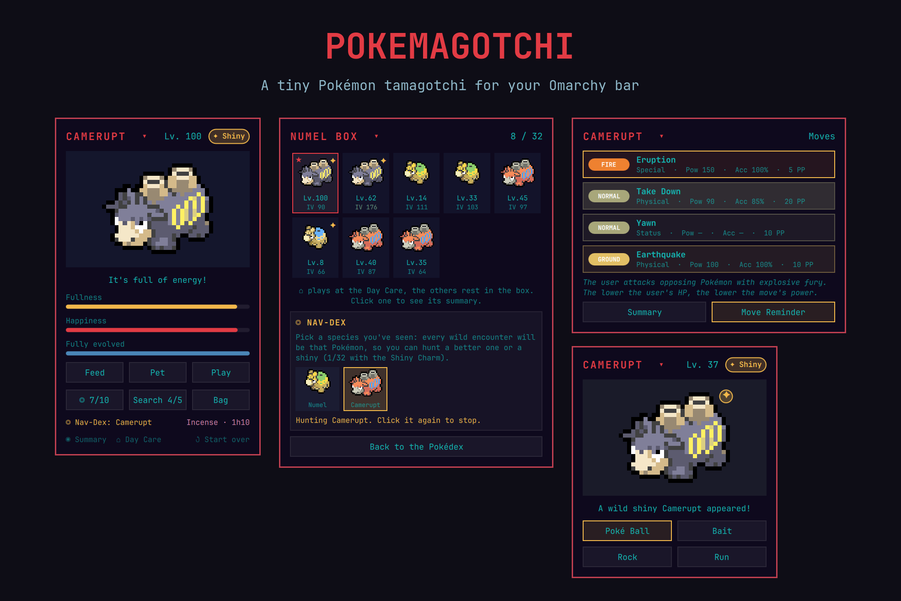
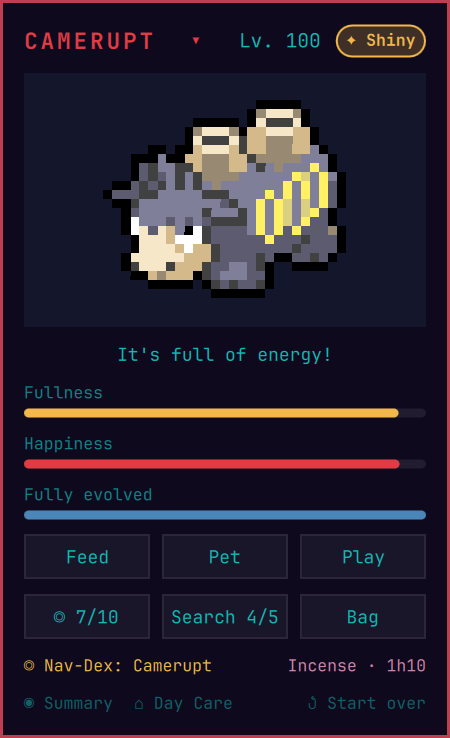
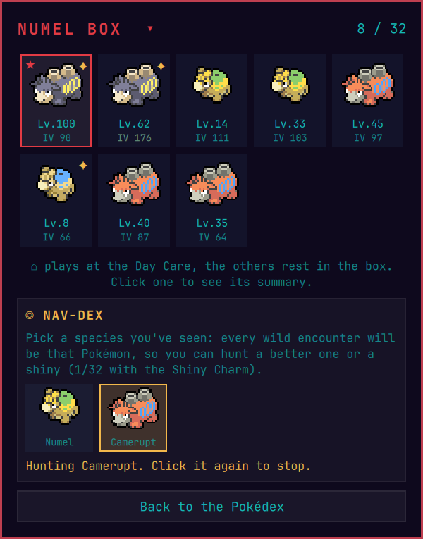
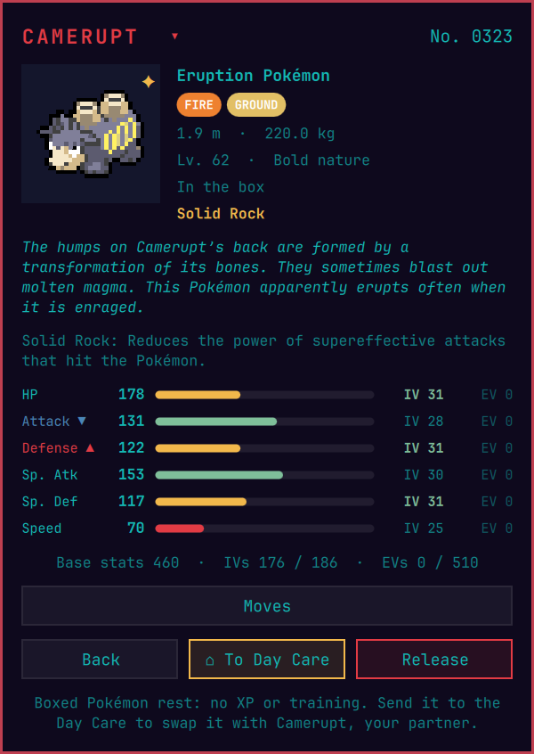
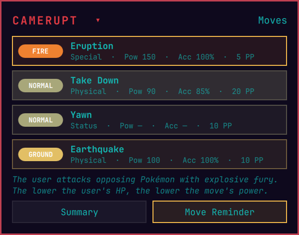
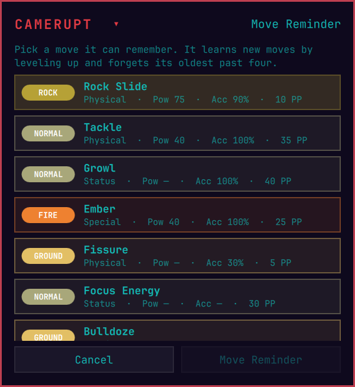
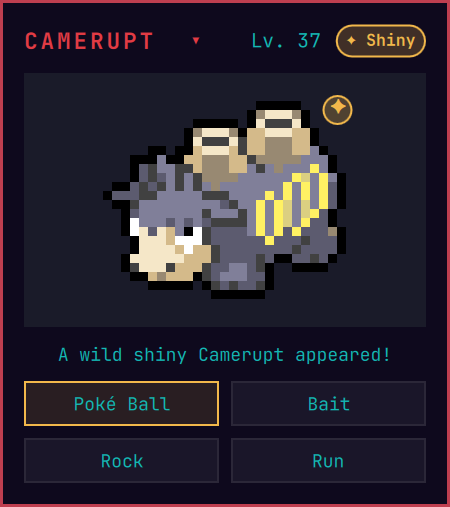
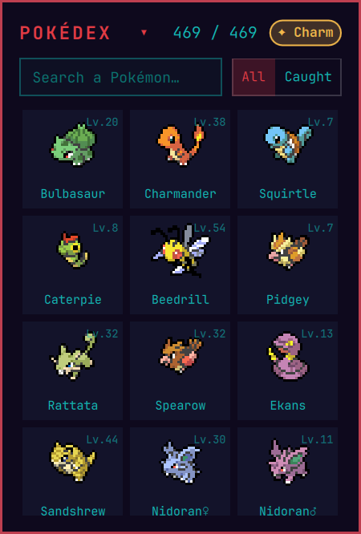
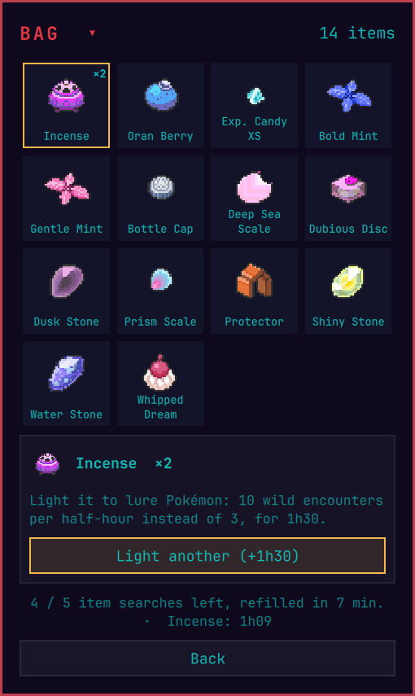
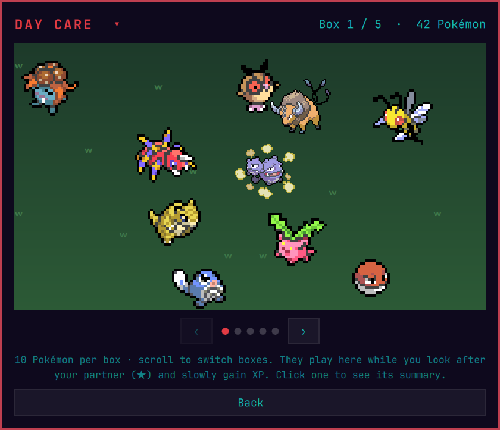

# Pokemagotchi

**A tiny Pokémon tamagotchi that lives in your Omarchy bar.**

Raise a partner Pokémon next to your clock, explore the tall grass between two
commits, catch all 905 Pokémon (Gen 1–8), fill their boxes, hunt shinies with
the Nav-Dex, train them against a Substitute doll and teach them their moves.



## Features

- **A partner in your bar.** Your Pokémon sits in the bar. Click it to feed, pet
  and play with it. Keep it full and happy and it gains XP over time.
- **Safari encounters.** Up to 3 wild Pokémon every half hour. Throw Poké Balls,
  bait or rocks, or run away. Rarer Pokémon show up less often and are harder to catch.
- **Pokédex and boxes.** Catch the same Pokémon as many times as you like:
  every family has a box of up to **32 Pokémon**. Click a Pokédex entry to open
  its box. You can view each Pokémon's summary, send it to the Day Care,
  release it or manage its moves.
- **Nav-Dex.** Pick any species you have already seen and lock every wild
  encounter on it. Use it to hunt one with better IVs, its hidden ability or a shiny.
- **Shiny Charm.** Catch one Pokémon from every family (469 / 469) to earn the
  Shiny Charm, like completing the Pokédex in the main games. It doubles your
  shiny odds from **1/64** to **1/32**.
- **Moves.** Pokémon learn their real level-up moves (from the latest main-series
  game that has them) as they grow. They keep the four most recent and learn
  more when they evolve. The **Move Reminder** brings back any move they know.
- **Items.** Search for items **5 times every half hour**. You can find berries
  (XP boosts), Exp. Candies, Rare Candies, Mints (nature), Bottle Caps (IVs),
  every evolution item and the **Incense**: light it to get **10 encounters per
  half hour instead of 3, for 1h30**.
- **Evolution.** Pokémon evolve by level, by item, with high friendship, with a
  strong bond, or at a certain time of day. When a Pokémon can evolve in more than
  one way, you choose which.
- **Real stats.** Every Pokémon has IVs, a nature, an ability (with a 1/20
  chance of its hidden ability), EVs and stats computed with the main-series formula.
- **Day Care and training.** The Pokémon you aren't walking with play at the
  Day Care and slowly gain XP. Up to 5 of them can train EVs or levels against
  the Substitute doll.

## Screenshots

| Partner | Box & Nav-Dex | Summary |
| :---: | :---: | :---: |
|  |  |  |
| **Moves** | **Move Reminder** | **Wild encounter** |
|  |  |  |
| **Pokédex (Shiny Charm)** | **Bag** | **Day Care** |
|  |  |  |

## Installation

Requires an Omarchy version with shell plugins (tested on Omarchy 4.0.4). No
other dependency: `notify-send` (libnotify, included with Omarchy) is only used
for the evolution and capture notifications.

```bash
omarchy plugin add https://github.com/Ch4rybd3/pokemagotchi.git --enable
```

The command clones the repository into `~/.config/omarchy/plugins/ch4rybd3.pokemagotchi`,
validates it and asks where to put the widget in your bar (right by default).
To move it later:

```bash
omarchy bar move ch4rybd3.pokemagotchi --section left   # left | center | right
```

### Manual installation

```bash
git clone https://github.com/Ch4rybd3/pokemagotchi.git \
  ~/.config/omarchy/plugins/ch4rybd3.pokemagotchi
omarchy plugin enable ch4rybd3.pokemagotchi
```

### Updating

```bash
omarchy plugin update ch4rybd3.pokemagotchi
```

Saves from earlier versions are upgraded automatically the first time the new
version opens.

## Uninstall

```bash
omarchy plugin remove ch4rybd3.pokemagotchi
```

Your save is kept in case you come back. To delete it too:

```bash
rm ~/.local/state/omarchy/pokemagotchi.json
```

## How to play

Click the Pokémon (or the Poké Ball when you have none yet) in your bar.

| Where | What you can do |
| --- | --- |
| Main screen | **Feed**, **Pet**, **Play**, **Wild** (encounter), **Search** (item), **Bag**. Click your partner for its summary. |
| Title (`NAME ▾`) | Opens the **Pokédex**. Search by name, filter to caught families, click an entry to open its **box**. |
| Box | All your Pokémon of that family (⌂ = at the Day Care, ★ = partner) and the **Nav-Dex** for that family. |
| Summary | Stats, IVs, EVs, nature and ability. Buttons for **Evolve**, **Train**, **Moves**, **Make partner**, **To Day Care** and **Release**. |
| Moves | Click a move to see its description. **Move Reminder** brings back an older move. |
| Day Care | Your other Pokémon wandering around, 10 per box. Scroll to switch boxes. |

### Game rules

| Rule | Value |
| --- | --- |
| Hunger / boredom | −6 fullness and −5 happiness per hour (partner only) |
| Passive XP | 36 XP/h for your partner while fullness and happiness are ≥ 50; 12 XP/h at the Day Care |
| Level | 5 + XP / 10, up to Lv. 100 |
| Wild encounters | 3 per half hour (10 with Incense), refilled at :00 and :30. Wild Pokémon are Lv. 1–40 |
| Item searches | 5 per half hour |
| Shiny odds | 1/64, or 1/32 with the Shiny Charm |
| Box size | 32 Pokémon per family, the Day Care one included |
| Incense | 10 encounters per half hour for 1h30. Lighting another one adds 1h30 |
| Friendship evolutions | Happiness ≥ 80 |
| Fairy (bond) evolutions | 15 rewarded pets |
| Day / night | Day is 8:00–20:00 |
| Training | 60 EVs/h (252 per stat, 510 total) or 40 XP/h; 5 Pokémon at once |

Boxed Pokémon rest: they don't gain XP and can't train. Send one to the Day Care
to swap it with the Pokémon there (your partner, if that's the one).

Wild Pokémon come from the families you haven't caught yet, unless the Nav-Dex
is on. Once you've caught every family, they come from every species whose box
still has room.

## Files and privacy

- Code and assets: `~/.config/omarchy/plugins/ch4rybd3.pokemagotchi/`
- Save: `~/.local/state/omarchy/pokemagotchi.json` (plain JSON, written only when
  you interact with the widget)

The plugin needs no network access and starts no background process. It only
runs `notify-send` for notifications and writes nothing but its save file.

## Development

| File | Role |
| --- | --- |
| `BarWidget.qml` | Bar button and popup UI |
| `Pet.js` | Game rules, save format and migrations (rates at the top of the file) |
| `Dex.js`, `Info.js`, `Items.js`, `Moves.js` | Generated game data |
| `PokeSprite.qml`, `ItemSprite.qml`, `SubstituteScene.qml` | Sprite helpers |
| `tools/gen-moves.py` | Regenerates `Moves.js` from the PokeAPI CSV dump |

Saving a file reloads the widget. Changes to the `.js` libraries are cached by
the QML engine, so restart the shell to pick them up:

```bash
omarchy restart shell
```

To regenerate the move data:

```bash
python3 tools/gen-moves.py /tmp/pokeapi-csv   # downloads the CSVs it needs
```

## Credits

- Pokémon sprites: [pokemon-colorscripts](https://gitlab.com/phoneybadger/pokemon-colorscripts)
  (MIT), based on [PokéSprite](https://github.com/msikma/pokesprite).
- Item sprites: [PokeAPI/sprites](https://github.com/PokeAPI/sprites).
- Pokédex entries, stats, abilities, natures, evolutions, items and moves: [PokeAPI](https://pokeapi.co)
  ([BSD-3-Clause](https://github.com/PokeAPI/pokeapi/blob/master/LICENSE.md)).

See [THIRD_PARTY_NOTICES.md](THIRD_PARTY_NOTICES.md).

## Legal

Pokemagotchi is an unofficial fan project, free and non-commercial. It is not
affiliated with, endorsed by or sponsored by Nintendo, Game Freak, Creatures Inc.
or The Pokémon Company. Pokémon and Pokémon character names are trademarks of
Nintendo, Creatures Inc. and Game Freak. All Pokémon images and names are
© Nintendo / Creatures Inc. / GAME FREAK inc.

The plugin's own code is released under the [MIT License](LICENSE).
